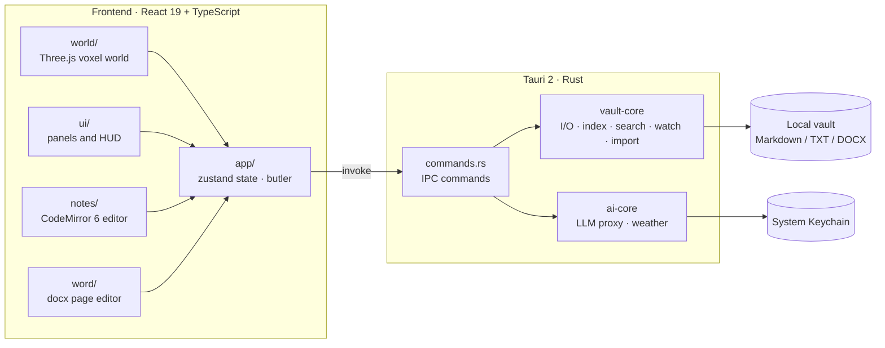

<div align="center">


# Pixel Study · 像素书房

**Your notes, shelved in a study you can walk into.**

First-person pixel world · local-file writing · shares a vault with Obsidian

**English** · [简体中文](README.zh-CN.md)

[](https://github.com/XingYujieee/pixel-study/actions/workflows/ci.yml)


</div>


> Walk up to a shelf, pull out a note, sit down at the desk and keep writing. The room makes organising fun; the text is always a plain local file you already know.

> [!NOTE]
> The app's interface is currently Chinese-only. Screenshots and shortcut names below are shown as they appear in the app.

## Contents

- [Highlights](#highlights)
- [Screenshots](#screenshots)
- [Getting started](#getting-started)
- [Controls](#controls)
- [Files and Obsidian](#files-and-obsidian)
- [Architecture](#architecture)
- [Development](#development)
- [Status and known limitations](#status-and-known-limitations)
- [Contributing](#contributing)
- [License and credits](#license-and-credits)

## Highlights

| | |
| :--- | :--- |
| 🏠 **Walk into your library** | Move with WASD and jump onto desks. Each bookshelf maps to a real folder, and new floors appear as the library grows. Seven room themes, plus day/night, weather and window views. |
| ✍️ **Notion-style writing** | Type `/` for a command menu, select text for a formatting toolbar, and press Tab to move through table cells. Lines without the cursor render live, while the file stays Obsidian-compatible Markdown. |
| 📄 **Word documents too** | `.docx` files open in a page-style editor on the desk. You get a warning before any formatting could be lost, and the original is backed up before the first save. |
| 🦉 **A butler bird** | Press `G` to call it. Ask where a note is and it flies you there; ask it to sort the shelves, plant trees or pull weeds. Connect an LLM and you can chat freely. It always asks before changing files. |
| 🌿 **Yard and garden** | The south door opens onto a fenced garden with flower beds, a vegetable patch and a well. A few weeds sprout each day; pull them by hand. |
| 🐱 **Pets and sound** | Cats, dogs, rabbits, chicks and foxes follow you around. Footsteps, rain and the fireplace are synthesised live, and background music is composed on the fly in six styles. |
| 🔒 **Local-first** | No account and no cloud sync. Imports copy, removals go to `.trash/`, and every save checks for outside edits. API keys live in the system Keychain. |

The full feature tour (Chinese) is in [docs/功能导览.md](docs/功能导览.md).

## Screenshots

<table>
  <tr>
    <td width="50%"><br /><sub><b>Library</b>: one shelf per folder, labelled on top</sub></td>
    <td width="50%"><br /><sub><b>Yard</b>: a fenced garden right outside the door</sub></td>
  </tr>
  <tr>
    <td><br /><sub><b>Butler</b>: finds notes, guides you, tidies shelves, gardens</sub></td>
    <td><br /><sub><b>Live preview</b>: toolbar, callouts, to-dos and tables</sub></td>
  </tr>
  <tr>
    <td><br /><sub><b>Slash menu</b>: filter by typing, including pinyin initials</sub></td>
    <td><br /><sub><b>Word</b>: edit .docx right on the desk</sub></td>
  </tr>
</table>

## Getting started

### Prerequisites

| Tool | Version |
| :--- | :--- |
| macOS | 11 Big Sur or later (the primary target for now) |
| Node.js | 22 |
| pnpm | 10 |
| Rust | stable |
| Xcode Command Line Tools | `xcode-select --install` |

### Run

```bash
git clone https://github.com/XingYujieee/pixel-study.git
cd pixel-study
pnpm install
pnpm tauri dev
```

On first launch, pick an existing Obsidian vault or an empty folder for a new one. Back up important notes before you start.

### Build

```bash
pnpm tauri build
```

Alternatively, double-click `构建像素书房.command` in the repo. The bundle lands in `src-tauri/target/release/bundle/`. Local builds are not signed or notarised for distribution, so the first time you open the app, right-click it in Finder and choose **Open**.

Pushing a `v*` tag makes CI build a universal `.dmg` on macOS and attach it to a GitHub Release.

## Controls

<table>
<tr><th>In the study</th><th>In the editor</th></tr>
<tr valign="top"><td>

| Key | Action |
| :--- | :--- |
| `W A S D` / `Space` | Move / jump |
| `Left click` / `E` | Interact with what the crosshair targets |
| `Right click` / `R` | Place / rotate furniture |
| `1`–`9` `0` `-` `=` | Hotbar slots (`=` is stairs) |
| `X` | Remove furniture (files are kept) |
| `G` | Call the butler |
| `T` / `P` / `M` | Room theme / pets / sound |
| `C` | Jot down an idea |
| `H` | Help |
| `Esc` | Menu / close panel |

</td><td>

| Key | Action |
| :--- | :--- |
| `/` (`、` with a Chinese IME) | Command menu |
| `⌘B` `⌘I` `⌘U` | Bold / italic / underline |
| `⌘⇧X` `⌘⇧H` `⌘⇧E` | Strikethrough / highlight / inline code |
| `⌘⌥1`–`3` | Heading levels 1–3 |
| `⌘⇧7` `⌘⇧8` `⌘⇧9` | Numbered / bulleted / to-do list |
| `⌘↩` | Toggle to-do |
| `Tab` / `⇧Tab` | Next / previous table cell |
| `⌘S` / `⌘E` | Save / toggle preview |
| `⌘K` | Search (`⌥↩` walks you to the shelf) |
| `⌘J` | Study ↔ focus writing |
| `⌘⇧I` | Quick capture from anywhere |

</td></tr>
</table>

## Files and Obsidian

```text
Your vault/
├── Notes/          new notes go here by default
├── Inbox/          quick ideas from the fish pond
├── Templates/      your templates (shared with Obsidian's Templates plugin)
├── Imports/        dropped-in files waiting to be shelved
├── Attachments/    images and other material
└── .trash/         removed files, restorable
```

- **Open an existing vault as-is.** Markdown, TXT and attachments stay ordinary files. Room layout and other app data live in the app's data directory; `.obsidian` settings are never rewritten.
- **Compatible syntax.** `[[note]]`, `[[note|alias]]`, `![[image]]`, relative links, tags, `==highlight==`, `> [!note]` callouts and YAML properties all work, and unknown syntax is preserved on save.
- **Two kinds of shelf.** Collection shelves hold references, so one file can sit in several places. Folder shelves show a real directory. Removing furniture never deletes text.
- **Safe saving.** Autosave, `⌘S`, draft recovery and conflict prompts for outside edits. Imports only copy; on a name clash, both copies are kept.

Advanced plugin syntax such as Dataview and Canvas is not rendered. If you edit the same note in Obsidian at the same time, read the conflict prompt before choosing which version to keep.

## Architecture



<details>
<summary><b>Project layout</b></summary>

```text
pixel-study/
├── src/                     frontend
│   ├── app/                 global state, actions, butler
│   ├── world/               3D scene, furniture models, terrain, sound and music
│   ├── notes/               Markdown sessions, live preview, slash menu
│   ├── word/                Word reading/writing and page editor
│   ├── ui/                  React UI
│   ├── ipc/                 Tauri command bindings
│   └── lib/                 paths, links, HTML sanitising and other helpers
├── src-tauri/
│   ├── src/                 Tauri entry point and commands
│   └── crates/
│       ├── vault-core/      vault I/O, scanning, index, search, watcher, import
│       └── ai-core/         LLM requests and tool calling, weather
├── scripts/                 test-vault generator, browser end-to-end scripts
└── docs/                    feature tour, checklist, PRD, test reports
```

</details>

## Development

```bash
pnpm dev                    # frontend dev server only
pnpm tauri dev              # desktop app
pnpm typecheck              # type check
pnpm test                   # frontend unit tests (Vitest)
pnpm build                  # frontend production build
cargo test   --manifest-path src-tauri/Cargo.toml --workspace
cargo clippy --manifest-path src-tauri/Cargo.toml --workspace --all-targets -- -D warnings
pnpm gen:vault test-vault 1000   # generate a 1,000-note test vault
```

CI runs all of these checks on every push and pull request.

## Status and known limitations

Current version: **0.1.0**. The latest check is in the [2026-10-08 full-check report](docs/reports/2026-10-08-full-check.md) (Chinese): 139 frontend tests, 55 Rust tests and Clippy all pass.

- Only verified on macOS so far. CI builds and tests on Linux, but no Windows or Linux packages are published.
- Native window closing, IME candidate windows and Finder drag-and-drop still need manual testing on a real Mac; see the [checklist](docs/manual-checklist.md).
- `sprintf-js`, an indirect dependency of `mammoth`, has a moderate advisory with no upstream fix yet.
- The app's interface is Chinese only.

Earlier reports: [2026-10-06 test and fix report](docs/reports/2026-10-06-review.md) · [2026-10-07 editor acceptance](docs/reports/2026-10-07-markdown-editor.md). Product goals and scope are in the [PRD](docs/像素书房产品需求文档.md) (Chinese).

## Contributing

Issues and pull requests are welcome. Before you submit, please check that:

1. `pnpm typecheck && pnpm test && pnpm build` pass;
2. if you changed Rust code, `cargo test` and `cargo clippy -- -D warnings` pass;
3. any change that touches file I/O comes with tests and never overwrites user files.

## License and credits

Released under the [MIT License](LICENSE). The bundled pixel font keeps its own SIL Open Font License 1.1.

Built with these open-source projects:

- [Fusion Pixel Font](https://github.com/TakWolf/fusion-pixel-font) by TakWolf (SIL OFL 1.1); see [`src/assets/fonts/fusion-pixel/`](src/assets/fonts/fusion-pixel/) for the licenses
- [Tauri](https://tauri.app), [React](https://react.dev), [Three.js](https://threejs.org), [CodeMirror](https://codemirror.net), [zustand](https://github.com/pmndrs/zustand)
- [marked](https://marked.js.org), [DOMPurify](https://github.com/cure53/DOMPurify), [mammoth](https://github.com/mwilliamson/mammoth.js), [docx](https://docx.js.org)
- Weather data from [Open-Meteo](https://open-meteo.com)

---

<p align="center">A place in your own world for every idea. ✦</p>
