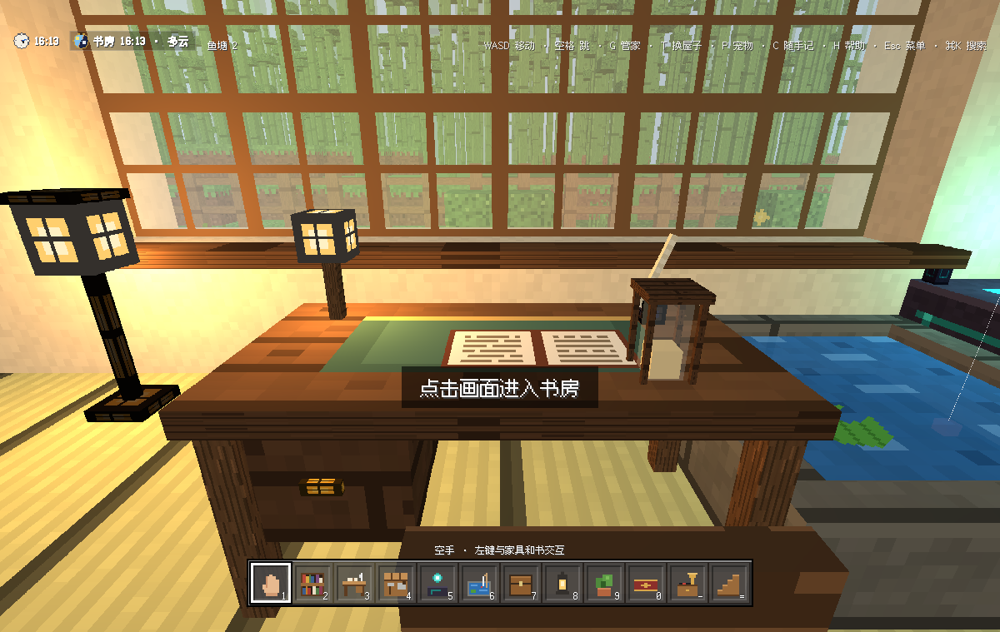
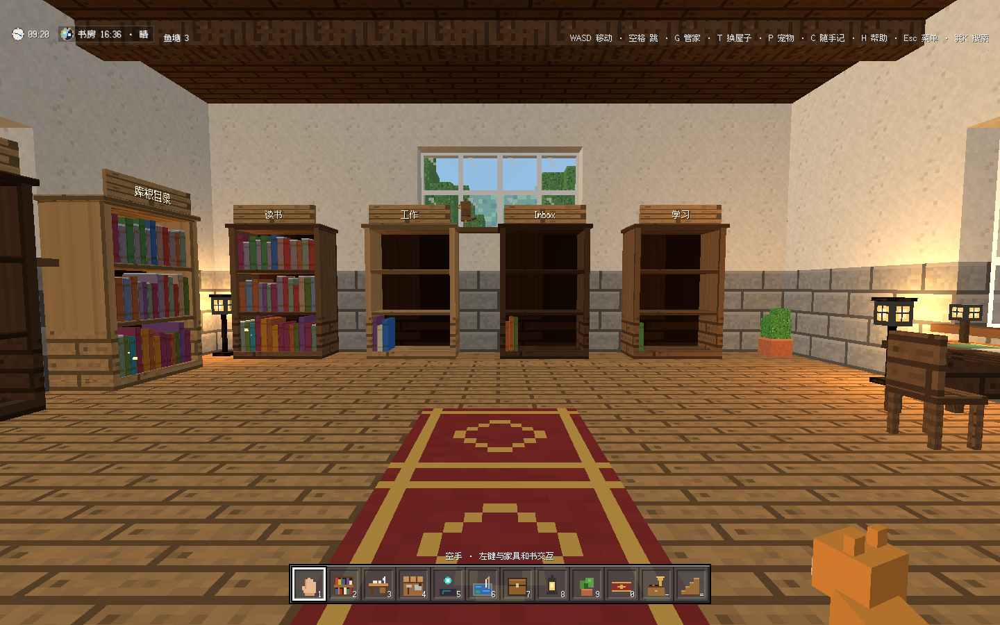
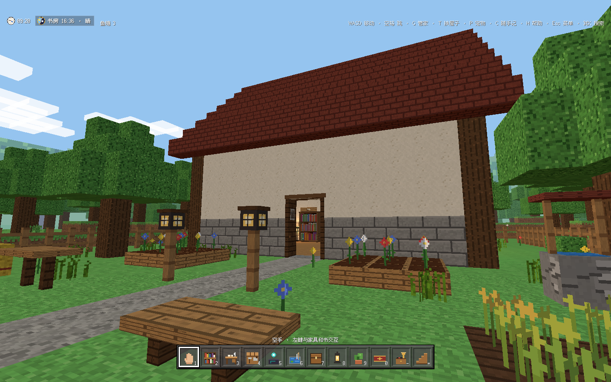
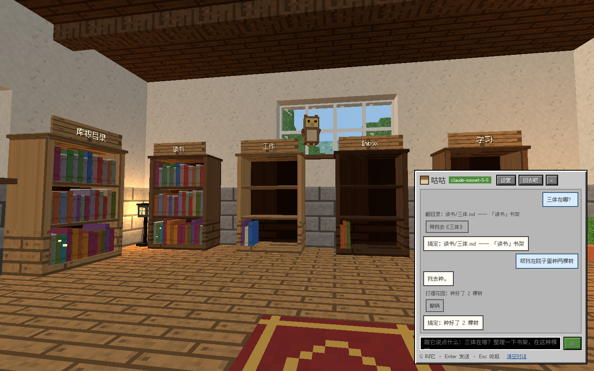
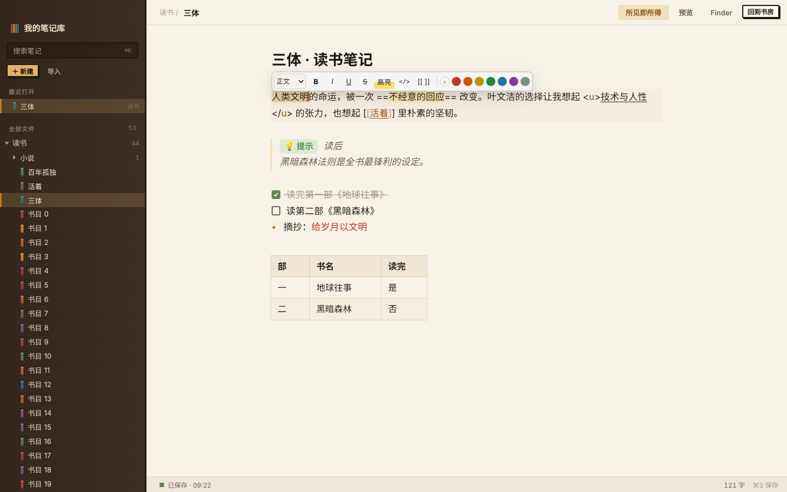
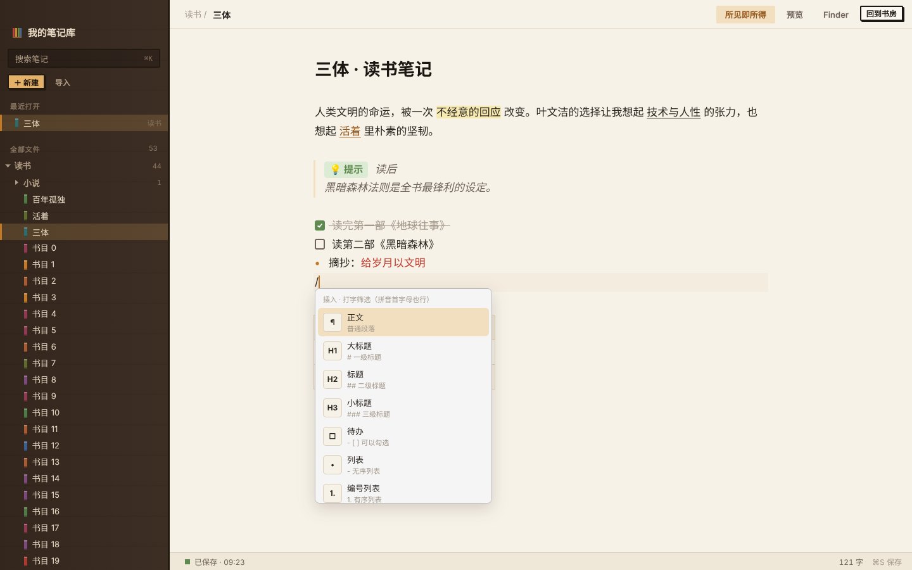
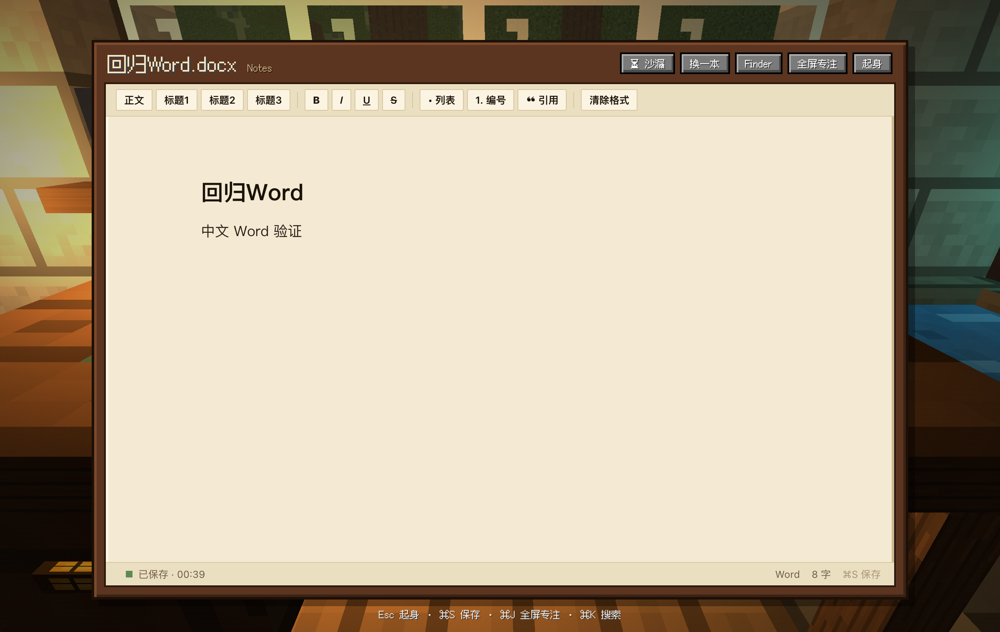
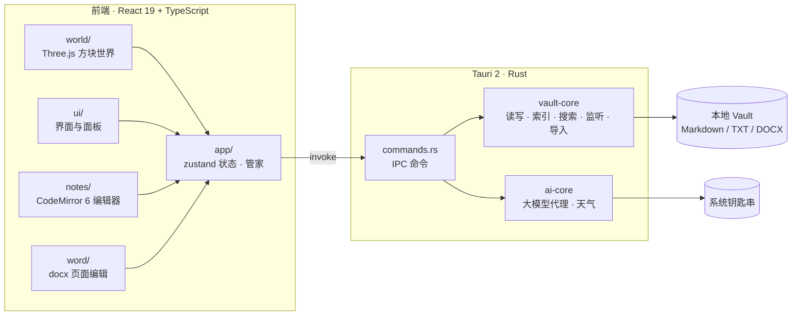

<div align="center">


# 像素书房 · Pixel Study

**把笔记放进一间可以走进去的书房。**

第一人称像素空间 · 本地文件写作 · 与 Obsidian 共用笔记库

[English](README.md) · **简体中文**

[](https://github.com/XingYujieee/pixel-study/actions/workflows/ci.yml)


</div>



> 走近书架，抽出一本笔记；坐到书桌前，继续写下去。空间负责让整理变得有趣，正文始终是你熟悉的本地文件。

## 目录

- [亮点](#亮点)
- [截图](#截图)
- [快速开始](#快速开始)
- [常用操作](#常用操作)
- [文件与 Obsidian](#文件与-obsidian)
- [架构](#架构)
- [开发](#开发)
- [当前状态与已知限制](#当前状态与已知限制)
- [参与贡献](#参与贡献)
- [许可与致谢](#许可与致谢)

## 亮点

| | |
| :--- | :--- |
| 🏠 **走进书房** | WASD 行走、跳上桌子；书架映射真实文件夹，书多了自动加楼层。七种屋子主题，昼夜、天气、窗景随时换。 |
| ✍️ **像 Notion 一样写** | 输入 `/` 打开命令菜单，选中文字出现格式工具条，表格用 Tab 跳格。光标不在的行直接显示排版效果，文件里仍是 Obsidian 认得的 Markdown。 |
| 📄 **Word 也能写** | `.docx` 在书桌上用页面式编辑器打开；可能丢失的格式会先提示，首次保存前自动备份。 |
| 🦉 **管家小鸟** | 按 `G` 叫出来。问"三体在哪"会带你过去；"整理书架""种两棵树""除草"都能交给它。接上大模型后可以随便聊，改动文件前一定先问你。 |
| 🌿 **院子与花园** | 推开南墙的门，围栏里的院子有花坛、菜地和水井。杂草每天长几棵，空手就能拔。 |
| 🐱 **宠物与声音** | 猫、狗、兔子、小鸡、狐狸会跟着你。脚步、雨声、壁炉都是现场合成；背景音乐有六种风格，每首都不重复。 |
| 🔒 **本地优先** | 不需要账号，也没有云同步。导入只复制，删除先进 `.trash/`，保存前检查外部修改。API 密钥存在系统钥匙串里。 |

完整功能清单见[功能导览](docs/功能导览.md)。

## 截图

<table>
  <tr>
    <td width="50%"><br /><sub><b>书架</b>：每个书架对应一个文件夹，名牌挂在顶上</sub></td>
    <td width="50%"><br /><sub><b>院子</b>：出了门就是带围栏的花园</sub></td>
  </tr>
  <tr>
    <td><br /><sub><b>管家</b>：找书、带路、整理书架、打理花园</sub></td>
    <td><br /><sub><b>所见即所得</b>：格式工具条、提示框、待办和表格</sub></td>
  </tr>
  <tr>
    <td><br /><sub><b>斜杠菜单</b>：支持拼音首字母筛选</sub></td>
    <td><br /><sub><b>Word</b>：在书桌上直接编辑 .docx</sub></td>
  </tr>
</table>

## 快速开始

### 环境要求

| 工具 | 版本 |
| :--- | :--- |
| macOS | 11 Big Sur 及以上（目前优先支持） |
| Node.js | 22 |
| pnpm | 10 |
| Rust | stable |
| Xcode Command Line Tools | `xcode-select --install` |

### 运行

```bash
git clone https://github.com/XingYujieee/pixel-study.git
cd pixel-study
pnpm install
pnpm tauri dev
```

启动后选择已有的 Obsidian Vault，或者选一个空文件夹作为新库。第一次使用前建议先备份重要笔记。

### 打包

```bash
pnpm tauri build
```

也可以双击仓库里的 `构建像素书房.command`。安装包在 `src-tauri/target/release/bundle/`。本地构建没有做公开发行签名和公证，第一次打开时请在访达里右键应用，选择"打开"。

推送 `v*` 标签时，CI 会在 macOS 上打包通用二进制 `.dmg` 并发布到 Releases。

## 常用操作

<table>
<tr><th>书房里</th><th>编辑器里</th></tr>
<tr valign="top"><td>

| 键 | 作用 |
| :--- | :--- |
| `W A S D` / `空格` | 移动 / 跳 |
| `左键` / `E` | 与准星指着的东西交互 |
| `右键` / `R` | 放置 / 旋转家具 |
| `1`–`9` `0` `-` `=` | 选物品栏（`=` 是楼梯） |
| `X` | 拆除家具（不删除文件） |
| `G` | 叫出管家 |
| `T` / `P` / `M` | 换屋子 / 宠物 / 声音 |
| `C` | 随手记一句灵感 |
| `H` | 帮助 |
| `Esc` | 菜单 / 关闭界面 |

</td><td>

| 键 | 作用 |
| :--- | :--- |
| `/`（中文输入法下 `、`） | 命令菜单 |
| `⌘B` `⌘I` `⌘U` | 粗体 / 斜体 / 下划线 |
| `⌘⇧X` `⌘⇧H` `⌘⇧E` | 删除线 / 高亮 / 行内代码 |
| `⌘⌥1`–`3` | 一到三级标题 |
| `⌘⇧7` `⌘⇧8` `⌘⇧9` | 编号 / 列表 / 待办 |
| `⌘↩` | 勾选待办 |
| `Tab` / `⇧Tab` | 表格里跳格 |
| `⌘S` / `⌘E` | 保存 / 切换预览 |
| `⌘K` | 搜索（`⌥↩` 带你去书架） |
| `⌘J` | 书房 ↔ 专注写作 |
| `⌘⇧I` | 任何地方随手记 |

</td></tr>
</table>

## 文件与 Obsidian

```text
你的 Vault/
├── Notes/          新建笔记默认放这里
├── Inbox/          鱼塘里的灵感速记
├── Templates/      自定义模板（与 Obsidian 模板插件共用）
├── Imports/        拖进来还没上架的文件
├── Attachments/    图片与其他资料
└── .trash/         移除的文件，可以撤销
```

- **直接打开现有 Vault**：Markdown、TXT 和附件都是普通文件。书房布局等附加数据保存在应用数据目录，不改写 `.obsidian` 配置。
- **语法互通**：支持 `[[笔记]]`、`[[笔记|别名]]`、`![[图片]]`、相对链接、标签、`==高亮==`、`> [!note]` 提示框和 YAML 属性；保存时保留不认识的语法。
- **两种书架**：收藏书架只放引用，一个文件可以出现在多处；文件夹书架显示真实目录。拆除家具不会删除正文。
- **保存有退路**：自动保存、`⌘S`、草稿恢复、外部修改冲突提示；导入只复制，同名时保留两份。

暂不渲染 Dataview、Canvas 等高级插件语法。和 Obsidian 同时编辑同一篇笔记时，请先看冲突提示，再决定保留哪个版本。

## 架构



<details>
<summary><b>项目结构</b></summary>

```text
pixel-study/
├── src/                     前端
│   ├── app/                 全局状态、操作、管家
│   ├── world/               3D 场景、家具模型、地形、音效与音乐
│   ├── notes/               Markdown 会话、所见即所得、斜杠菜单
│   ├── word/                Word 读写与页面编辑
│   ├── ui/                  React 界面
│   ├── ipc/                 Tauri 命令封装
│   └── lib/                 路径、链接、HTML 清理等工具
├── src-tauri/
│   ├── src/                 Tauri 入口与命令
│   └── crates/
│       ├── vault-core/      库的读写、扫描、索引、搜索、监听、导入
│       └── ai-core/         大模型请求与工具调用、天气
├── scripts/                 测试库生成器、浏览器端到端脚本
└── docs/                    功能导览、验收清单、PRD、测试报告
```

</details>

## 开发

```bash
pnpm dev                    # 只启动前端开发服务器
pnpm tauri dev              # 启动桌面应用
pnpm typecheck              # 类型检查
pnpm test                   # 前端单元测试（Vitest）
pnpm build                  # 前端构建
cargo test   --manifest-path src-tauri/Cargo.toml --workspace
cargo clippy --manifest-path src-tauri/Cargo.toml --workspace --all-targets -- -D warnings
pnpm gen:vault test-vault 1000   # 生成 1000 篇笔记的测试库
```

每次推送和 PR 都会在 CI 里跑上面这些检查。

## 当前状态与已知限制

当前版本 **0.1.0**，最近一次检查见 [2026-10-08 全面检查报告](docs/reports/2026-10-08-full-check.md)：139 项前端测试、55 项 Rust 测试、Clippy 全部通过。

- 目前只在 macOS 上验证过。CI 会在 Linux 上编译和测试，但没有发布 Windows 和 Linux 安装包。
- 原生窗口关闭、输入法候选窗和访达拖放还需要真机人工验收，见[检查清单](docs/manual-checklist.md)。
- `mammoth` 的间接依赖 `sprintf-js` 有一个中危公告，上游暂无修复版本。
- 应用界面目前只有中文。

历史报告：[2026-10-06 测试与修复](docs/reports/2026-10-06-review.md) · [2026-10-07 编辑器补充验收](docs/reports/2026-10-07-markdown-editor.md) · 产品目标与边界见 [PRD](docs/像素书房产品需求文档.md)。

## 参与贡献

欢迎提 Issue 和 PR。提交前请确认：

1. `pnpm typecheck && pnpm test && pnpm build` 通过；
2. 改动了 Rust 时，`cargo test` 和 `cargo clippy -- -D warnings` 通过；
3. 涉及读写文件的改动附上测试，永远不要覆盖用户文件。

## 许可与致谢

项目许可证尚未确定，在仓库加入 `LICENSE` 之前保留所有权利。

感谢这些开源项目：

- [Fusion Pixel Font](https://github.com/TakWolf/fusion-pixel-font)（TakWolf，SIL OFL 1.1），许可见 [`src/assets/fonts/fusion-pixel/`](src/assets/fonts/fusion-pixel/)
- [Tauri](https://tauri.app)、[React](https://react.dev)、[Three.js](https://threejs.org)、[CodeMirror](https://codemirror.net)、[zustand](https://github.com/pmndrs/zustand)
- [marked](https://marked.js.org)、[DOMPurify](https://github.com/cure53/DOMPurify)、[mammoth](https://github.com/mwilliamson/mammoth.js)、[docx](https://docx.js.org)
- 天气数据来自 [Open-Meteo](https://open-meteo.com)

---

<p align="center">在自己的世界里，给每一个想法留一个位置。 ✦</p>
